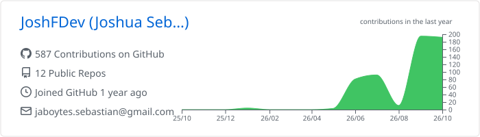
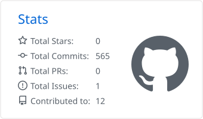
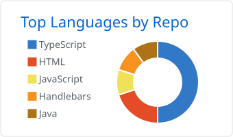
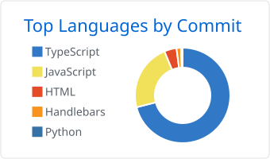

 

 

## About me

Computer Engineering student focused on backend development. I enjoy building the part of an application that users don't see: APIs, data modeling and business logic, on top of an architecture that can be maintained and scaled.

I mainly work with **Java (Spring Boot)**, **C# (.NET)** and **JavaScript/TypeScript (Node.js)**, and I'm comfortable on the frontend side to integrate and consume services end to end.

**Currently**
- Going deeper into relational and non-relational databases.
- Improving my software architecture practices.
- Working toward becoming a solid backend developer.

 

## How I work

- **Architecture first.** Well-separated layers and clear responsibilities, so the system can grow without breaking.
- **Predictable APIs.** Consistent contracts, validation and error handling, tested before they are integrated.
- **Maintainable code.** Readable, with expressive names and good practices, thinking of whoever reads it next.

 

## Tech stack

**Languages**  

**Backend**  

**Frontend**  

**Databases**  

**Tools**  

**AI-assisted development**  

<b>What do I use each tool for?</b>

 

**Languages**
- **Java:** business logic and APIs with Spring; the core of my backend work.
- **C#:** services and APIs on .NET.
- **JavaScript:** server-side with Node.js and client-side behavior.
- **TypeScript:** static typing for safer, more maintainable code.
- **Python:** scripting, automation and quick prototyping.

**Backend**
- **Spring Boot / Spring:** Java services and REST APIs with dependency injection, layered design and fast configuration.
- **Node.js + Express:** lightweight REST APIs on server-side JavaScript.
- **.NET:** Microsoft's platform for services built with C#.
- **JavaServer Faces (JSF):** component-based, server-side web interfaces in Java.

**Frontend**
- **React / Next.js:** component-based UIs and server-side rendering to consume my APIs.
- **Angular:** structured applications with TypeScript.
- **Bootstrap:** fast, consistent responsive layouts.

**Databases**
- **MySQL / PostgreSQL:** relational modeling, SQL queries and data integrity.
- **MongoDB:** document-oriented database for flexible data.

**Tools**
- **Git / GitHub:** version control, branching and automation with Actions.
- **Postman:** testing and documenting endpoints.
- **Jira:** task management and agile workflow.

**AI-assisted development**
- **Claude Code, Codex, OpenCode and Big Pickle:** support for exploring, reviewing and refactoring code. I review and validate everything that goes into my projects.

 

## GitHub activity

<picture>
  <source media="(prefers-color-scheme: dark)" srcset="./profile-summary-card-output/github_dark/0-profile-details.svg">
  
</picture>
<picture>
  <source media="(prefers-color-scheme: dark)" srcset="./profile-summary-card-output/github_dark/3-stats.svg">
  
</picture>

<picture>
  <source media="(prefers-color-scheme: dark)" srcset="./profile-summary-card-output/github_dark/1-repos-per-language.svg">
  
</picture>
<picture>
  <source media="(prefers-color-scheme: dark)" srcset="./profile-summary-card-output/github_dark/2-most-commit-language.svg">
  
</picture>

<!--
Optional: animated contribution graph (snake).
Remove these comment marks to show it again.

  <picture>
    <source media="(prefers-color-scheme: dark)" srcset="https://raw.githubusercontent.com/JoshFDev/JoshFDev/output/github-contribution-grid-snake-dark.svg" />
    <source media="(prefers-color-scheme: light)" srcset="https://raw.githubusercontent.com/JoshFDev/JoshFDev/output/github-contribution-grid-snake.svg" />
    
  </picture>

-->

<!--
Optional: featured projects. Replace REPO_NAME with your repositories.

## Featured projects

-->

 

<b>Beyond the code</b>

 

- **Star Wars:** discipline, storytelling and building something bigger than yourself.
- **Superman:** consistency and doing the right thing even when nobody is watching.
- **Green Lantern (John Stewart):** an architect by trade; precision, design and the willpower to build with detail.

 

  Willpower, precision and consistency. Thanks for visiting my profile.

