 

 

## About me

Computer Engineering student and backend developer. I design and build REST APIs and server-side applications, from data modeling and business logic to integration with the frontend.

My main stack is Java with Spring Boot, C# with .NET, and Node.js with Express (JavaScript/TypeScript). I work with relational (MySQL, PostgreSQL) and non-relational (MongoDB) databases, and use React, Next.js and Angular to integrate services end to end.

> **Currently:** deepening my knowledge of databases and software architecture.

 

## How I work

- **Architecture first.** Well-separated layers and clear responsibilities, so the system can grow without breaking.
- **Predictable APIs.** Consistent contracts, validation and error handling, tested before they are integrated.
- **Maintainable code.** Readable, with expressive names and good practices, thinking of whoever reads it next.

 

## Tech stack

<b>LANGUAGES</b> 

  

<b>BACKEND</b> 

  

<b>FRONTEND</b> 

  

<b>DATABASES</b> 

  

<b>TOOLS</b> 

  

<b>AI-ASSISTED DEVELOPMENT</b> 

 

<b>What do I use each tool for?</b>

 

**Languages**
- **Java:** business logic and APIs with Spring; the core of my backend work.
- **C#:** services and APIs on .NET.
- **JavaScript / TypeScript:** server-side with Node.js, with static typing for safer code.
- **Python:** scripting, automation and quick prototyping.

**Backend**
- **Spring Boot / Spring:** services and REST APIs with dependency injection and fast configuration.
- **Node.js + Express:** lightweight REST APIs on JavaScript.
- **.NET:** services built with C# on Microsoft's platform.
- **JavaServer Faces:** component-based, server-side web interfaces.

**Frontend**
- **React / Next.js:** component-based UIs and server-side rendering to consume my APIs.
- **Angular:** structured applications with TypeScript.
- **Bootstrap:** fast, consistent responsive layouts.

**Databases**
- **MySQL / PostgreSQL:** relational modeling, SQL queries and data integrity.
- **MongoDB:** document-oriented database for flexible data.

**Tools and AI**
- **Git / GitHub:** version control and automation with Actions.
- **Postman / Jira:** testing endpoints and managing work in an agile way.
- **Claude Code, Codex, OpenCode, Big Pickle:** support for exploring, reviewing and refactoring code. I review and validate everything that goes into my projects.

 

## GitHub

<picture>
  <source media="(prefers-color-scheme: dark)" srcset="./profile-summary-card-output/github_dark/0-profile-details.svg">
  
</picture>

<picture>
  <source media="(prefers-color-scheme: dark)" srcset="./profile-summary-card-output/github_dark/3-stats.svg">
  
</picture>
<picture>
  <source media="(prefers-color-scheme: dark)" srcset="./profile-summary-card-output/github_dark/1-repos-per-language.svg">
  
</picture>

 

